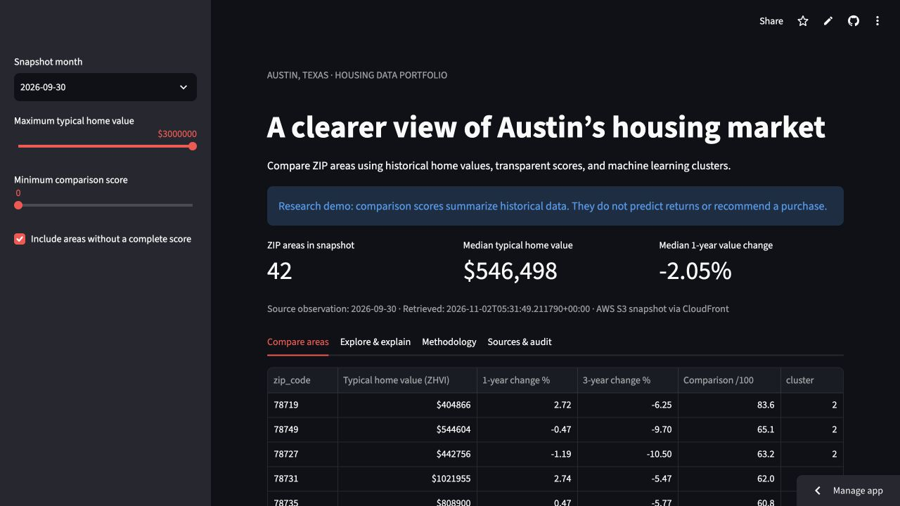

# Austin Real Estate Analyzer

A Python data pipeline and Streamlit dashboard for comparing Austin ZIP areas using historical Zillow home values, transparent scores, and K-Means clusters.

[Open the live dashboard](https://austin-real-estate-analyzer-d5mx2bhi5grprfmjggz83b.streamlit.app/) · [Browse the deployed source](https://github.com/spattoor/Austin-Real-Estate-Analyzer/tree/portfolio-cloud-upgrade)



## Working deployment

A weekly EventBridge schedule starts the five-stage Prefect pipeline in AWS CodeBuild. It publishes source files and SQLite snapshots to private, encrypted S3. CloudFront delivers the published snapshot to the dashboard without AWS credentials in the app. Downloads are checked against SHA-256 checksums and SQLite integrity checks.

The verified snapshot contains **546 rows across 42 Austin ZIP areas**, with observations through **September 30, 2026**. Both a manual AWS run and an EventBridge-triggered run succeeded. Eight pipeline tests and four snapshot-reader tests passed, and the public app restored its AWS snapshot after a reboot.

This deployed path uses **Prefect**. Scores describe historical data; they are not forecasts or investment-return estimates. This Zillow-only deployment does not establish seven verified sources or 50+ ZIP codes.

## Source and local setup

The current deployed application and AWS infrastructure templates are on **`portfolio-cloud-upgrade`**. Select that branch before following its setup instructions:

```bash
git clone https://github.com/spattoor/Austin-Real-Estate-Analyzer.git
cd Austin-Real-Estate-Analyzer
git switch portfolio-cloud-upgrade
python3.12 -m venv .venv
source .venv/bin/activate
python -m pip install -r deploy/requirements.txt
python -m streamlit run deploy/app.py
```

The included SQLite snapshot works without API credentials. Optional Gemini evidence selection requires separate provider configuration; tables and filters do not require it.

[Deployment and verification](https://github.com/spattoor/Austin-Real-Estate-Analyzer/blob/portfolio-cloud-upgrade/DEPLOYMENT.md) · [AWS refresh templates](https://github.com/spattoor/Austin-Real-Estate-Analyzer/tree/portfolio-cloud-upgrade/deploy/aws) · [Zillow data attribution](https://www.zillow.com/research/data/)
