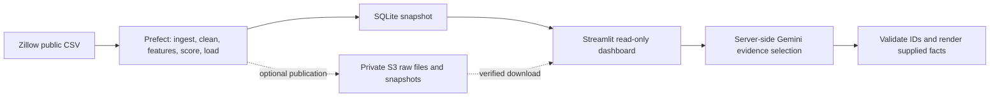

# Austin Market Explorer

A portfolio research dashboard comparing Austin ZIP areas with public Zillow home-value data, transparent Python scores, K-Means clusters, and optional Gemini evidence selection.

**Live demo:** pending deployment — replace with the verified Streamlit URL.

**Screenshot:** save a deployed screenshot to `docs/screenshot.png`, then add `` here. No screenshot or deployment is claimed yet.

## What works in this deployment path

- Download the public Zillow ZIP-level, smoothed, seasonally adjusted ZHVI dataset.
- Select rows with `State=TX` and `City=Austin`; preserve 13 monthly analysis snapshots in SQLite.
- Compute exact 1-year and 3-year historical changes. Missing observations remain null.
- Calculate a documented heuristic: 40% lower-price percentile, 35% 1-year-change percentile, 25% 3-year-change percentile.
- Run scikit-learn K-Means on standardized values and historical changes. Cluster IDs have no quality order and are local to each month.
- Optionally call Gemini to select relevant evidence IDs. Python validates those IDs and renders exact facts. A fallback is never labeled as AI.
- Include five Prefect stages, a Dockerfile, a manual/scheduled GitHub Actions workflow, and optional private S3 publication/restoration code. Files alone do not establish cloud execution.

ZHVI is a modeled typical home-value index, not a listing or median transaction price. Scores describe data; they do not predict returns or recommend purchases. The original Yelp scripts remain available as a separate older analysis path. This demo does not claim seven verified sources or predictive accuracy.

## Run locally

Use Python 3.12:

```bash
python3.12 -m venv .venv
source .venv/bin/activate
python -m pip install -r deploy/requirements.txt
python -m streamlit run deploy/app.py
```

Open the local URL shown by Streamlit. The bundled SQLite snapshot needs no account or API key. Source dates and retrieval time appear in the app.

## Refresh and verify

```bash
python -m pip install -r requirements-cloud.txt
PREFECT_SERVER_ANALYTICS_ENABLED=false python -m portfolio.refresh
python -m unittest discover -s tests -v
```

The flow runs `ingest → clean → features → score → load`, failing on source errors. Output: `deploy/data/austin.db`. Raw downloads under `data/raw/portfolio/` are ignored. A GitHub artifact alone does not update the app: configure S3 publication or commit a refreshed bundled snapshot.

## Architecture



## Environment variables and secrets

| Variable | Required | Purpose |
|---|---|---|
| `GEMINI_API_KEY` | AI only | Fresh server-side key; never commit |
| `GEMINI_MODEL` | No | Default `gemini-3.5-flash-lite`; verify project access |
| `AUSTIN_DB_PATH` | No | Local published SQLite path |
| `AUSTIN_S3_BUCKET` | S3 only | Private bucket containing `latest.json` |
| `AWS_DEFAULT_REGION` | S3 only | Bucket region |
| `AWS_ACCESS_KEY_ID`, `AWS_SECRET_ACCESS_KEY` | Hosted S3 reader only | Restricted read-only app identity; GitHub uses OIDC |

In Streamlit Community Cloud choose `deploy/app.py` and Python 3.12. Add secrets through Advanced settings → Secrets using `deploy/secrets.example.toml`. Streamlit installs the requirements file beside the entrypoint.

AI limits: three uncached calls/minute and twenty/24 hours per server process; successful responses cache for an hour. Restarts reset these controls. They are not provider spending caps. Use a free-only Gemini project without paid billing and inspect quotas. Only public housing facts are sent to the provider.

## Docker

```bash
docker build -t austin-market .
docker run --rm -p 8501:8501 austin-market
```

Never bake secrets into the image. The image runs the dashboard; refresh tooling runs separately with `requirements-cloud.txt`.

## Common failures

| Symptom | Action |
|---|---|
| Missing snapshot | Run the refresh and commit the generated DB for bundled hosting |
| Wrong Streamlit dependencies | Set the entrypoint to exactly `deploy/app.py` |
| AI 400/404 | Confirm model access in the fresh project; do not select an old model blindly |
| AI 429 | Check quota and app limits; comparison tables still work |
| S3 access denied | Check bucket region, reader policy, and OIDC branch trust |
| Workflow ran but app stayed unchanged | Artifacts do not publish to Streamlit; use S3 or update the bundled DB |

Data attribution: [Zillow Research](https://www.zillow.com/research/data/). Setup and verification status: [DEPLOYMENT.md](DEPLOYMENT.md).
